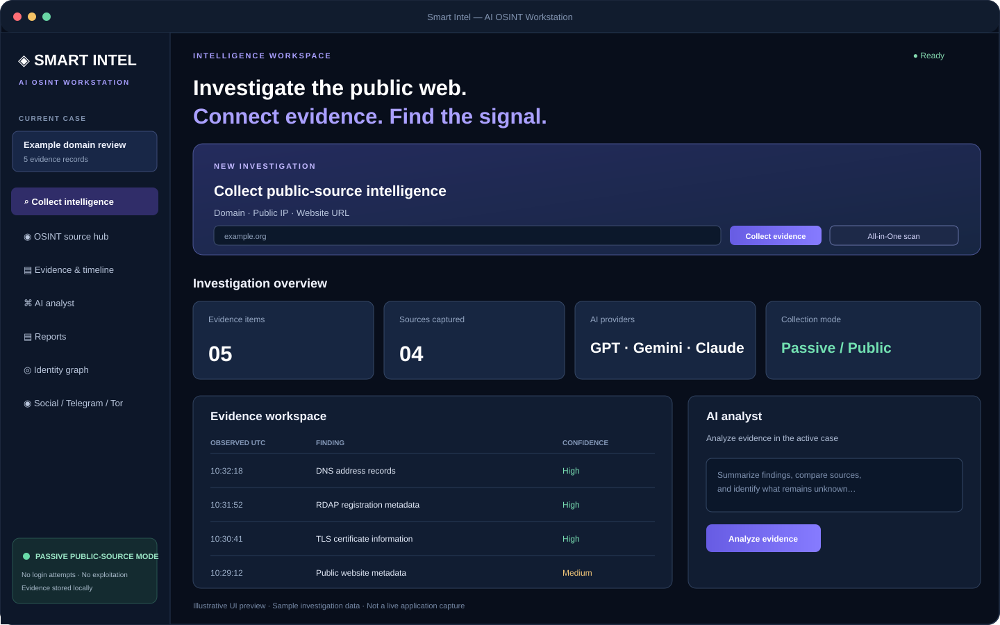
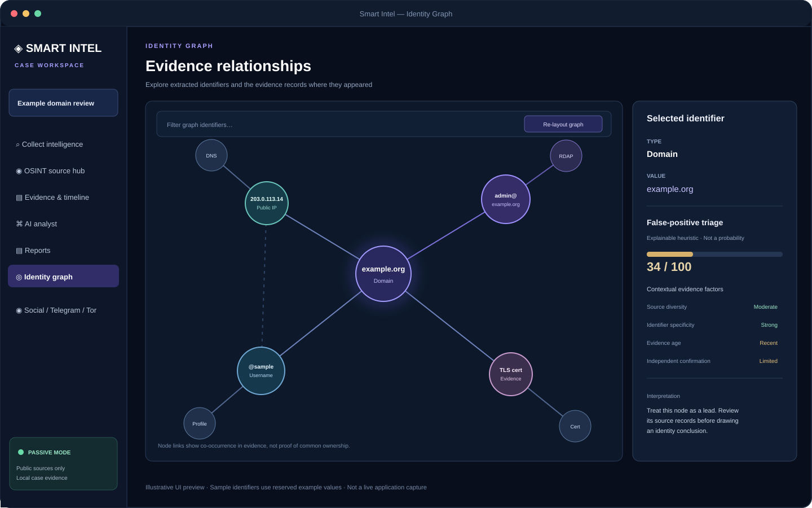
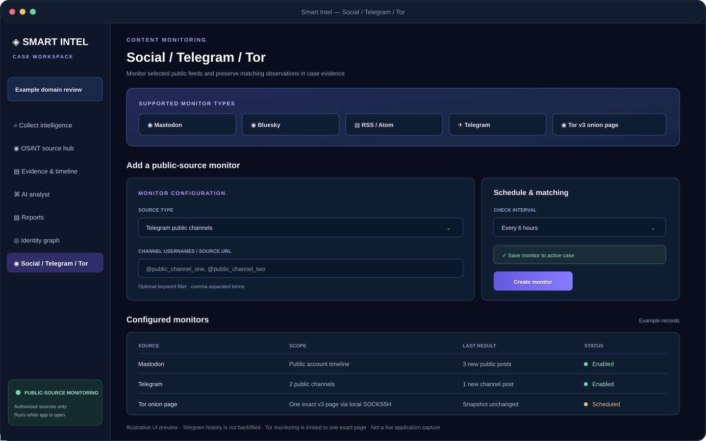

# Smart Intel — AI OSINT Workstation

**A cross-platform, AI-assisted OSINT desktop application built with Python and PyQt6.** Organize public-source research into cases, correlate findings, review evidence and use AI to help analyze what is known — and what is still unknown.

> The primary application is the PyQt6 desktop app in [desktop/](desktop/). This project is intended for lawful, authorized research of public information.

## Interface previews

The following artwork previews the current application's dark-first layout and major work areas. The records and identifiers shown are fictional sample data. These are **illustrative UI previews**, not screenshots captured from a running installation.

### Investigation workspace

### Evidence graph and relationship analysis

### Social, Telegram and Tor monitoring

## What it includes

- **Case-based investigation workspace** — local SQLite cases, evidence records, source provenance and user/case roles.
- **Passive collection workflows** — DNS, RDAP, TLS certificate and public website metadata collection, plus an All-in-One workflow that selects relevant collectors for the target type.
- **OSINT source hub** — integrations and lookup workflows for crt.sh, Wayback CDX, VirusTotal, AbuseIPDB, urlscan.io, AlienVault OTX, Shodan and Censys existing-host data, SecurityTrails passive DNS, GDELT, MISP exact-IOC search, public username reference links, and selected company/court/sanctions and authorized breach metadata sources. Provider keys, access, quotas and licensing conditions apply.
- **AI-assisted analysis** — local Ollama or optional OpenAI, Gemini and Claude providers. AI output is an analytical aid; it is not source verification.
- **Identity/evidence graph** — inspect identifiers and the evidence records where they appeared, with provenance and explainable triage factors. Graph links do not prove that two identifiers belong to the same person.
- **Evidence handling** — timeline filters, attachment hashing, optional encrypted evidence payloads, audit-event verification, signed export bundles, and optional SQLCipher database encryption.
- **Analyst utilities** — browser screenshot capture with Playwright, WARC records, local image metadata/EXIF inspection, image hashing and local image comparison.
- **Reports and exports** — JSON, CSV, STIX 2.1 note bundles, DOCX and PDF export helpers, plus HTML reports from the desktop interface.
- **Monitoring** — scheduled domain/IP/URL checks and selected public-content monitors. Local schedules run only while the desktop application is open.

## Social media, Telegram and Tor

The **Social / Telegram / Tor** tab supports narrowly scoped public-source monitoring:

| Source | Supported workflow |
|---|---|
| Mastodon | One explicitly supplied public account timeline; non-public statuses are excluded |
| Bluesky | Search public posts using the public AppView endpoint |
| RSS / Atom | Public HTTPS feeds, including supported YouTube channel feeds |
| Telegram | New posts from specified public channels through the official Bot API and a bot added to those channels |
| Tor onion | One exact v3 onion page through a locally configured Tor SOCKS5H proxy |

Keyword filters, scheduled checks, deduplication and case evidence storage are included. Telegram monitoring does not backfill channel history and requires a dedicated bot token; the Bot API's polling mode cannot be used while a webhook is configured. Tor monitoring fetches one specified page only — it does not crawl onion services, index directories, search marketplaces or download files.

This is not comprehensive coverage of every social platform. X, Instagram, Facebook, private communities and private messages are not supported monitoring sources.

## Quick start

~~~bash
git clone https://github.com/h84095111-hue/SMART-INTEL.git
cd SMART-INTEL/desktop

python -m venv .venv
# Windows PowerShell:
# .venv/Scripts/Activate.ps1
# macOS / Linux:
# source .venv/bin/activate

python -m pip install -r requirements.txt
python main.py
~~~

Python 3.10+ is recommended. Configure AI and provider credentials from **AI & network settings** in the app. API keys are stored through the operating-system credential store when available. Third-party services may impose usage fees, quotas or licensing requirements.

### Optional dependencies

Some capabilities require optional packages or separately installed software. See [desktop/README.md](desktop/README.md) for details about Playwright, SQLCipher, image analysis, Tor proxy setup, provider configuration, Telegram setup and local Ollama.

## Build

Build on the target operating system:

- Windows: **build_windows.bat**
- macOS: **./build_macos.sh**
- Linux: **./build_linux.sh**

See [desktop/BUILDING.md](desktop/BUILDING.md). PyInstaller builds should be produced on their target OS; public signed installers are not currently published.

## Responsible use and limitations

Smart Intel is designed for passive public-source research and evidence organization. It does not provide active port scanning, exploitation, login attempts, private-account scraping, challenge bypass or access-control bypass. Shodan and Censys integrations query existing provider observations; they do not initiate scans.

The application is still under active development and is not a production-hardened enterprise investigation platform. External providers control their own availability, API access, terms, data coverage and rate limits. Scheduled jobs are local to the running desktop app. Proxy or Tor routing is opt-in and is not an anonymity guarantee. AI summaries and risk scores are leads for analyst review, not verified facts or calibrated probabilities.

Use only sources and targets you are authorized to investigate. Respect privacy law, provider terms and rate limits. Do not submit personal information to external services unless you have a lawful basis to do so.

## Documentation

- [Desktop app guide and feature details](desktop/README.md)
- [Installation guide](docs/INSTALLATION.md)
- [User guide](docs/USAGE.md)
- [OSINT source integrations](docs/osint/SOURCES.md)
- [Capability matrix and roadmap](docs/osint/CAPABILITY-MATRIX.md)
- [Security and evidence handling](docs/osint/SECURITY.md)

## License

MIT — see [LICENSE](LICENSE).
