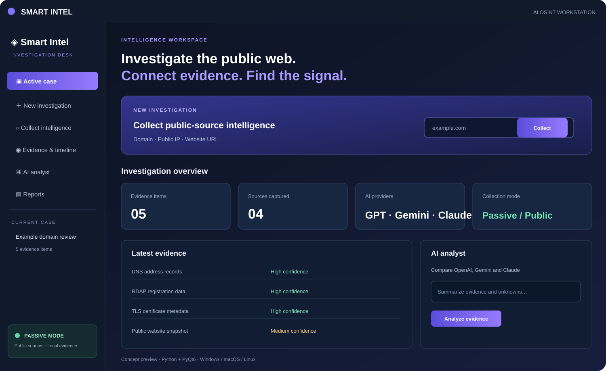

# Smart Intel — AI OSINT Workstation

**A cross-platform, AI-assisted OSINT desktop application built with Python + PyQt6.** Organize public-source research into cases, correlate findings, and analyze evidence with OpenAI, Gemini or Claude.

> This project replaces the original browser-based Smart Toolbox. The primary product is now the PyQt6 desktop app in [desktop/](desktop/).

## Desktop interface



*Illustrative concept artwork only — not a screenshot of the running application. A real screenshot is still required before release.*

## Available now

- PyQt6 desktop shell with a refined dark-first interface, local SQLite cases, evidence table and AI analyst.
- One-click **All-in-One Passive Scan**: auto-detects domain, public IP, URL, username or email, runs the relevant built-in collectors and configured OSINT providers, and keeps going when individual providers fail.
- Passive DNS/RDAP/TLS and public website metadata collection.
- Optional provider lookups: crt.sh certificate transparency, Wayback CDX, VirusTotal, AbuseIPDB, urlscan.io, AlienVault OTX, Shodan existing-host data, Censys existing-host data, SecurityTrails passive DNS, GDELT news and user-configured MISP exact-IOC search.
- Public username profile reference links (no account scraping or identity verification).
- Authorized breach-check workflow guidance; no stolen credential dumps.
- Interactive evidence/identity graph with source provenance and optional local Ollama analysis; OpenAI, Gemini and Claude remain optional cloud providers.
- Explainable false-positive risk index (uncalibrated heuristic, not a statistical probability).
- Evidence deduplication, heuristic source credibility and transparent triage scoring helpers.
- Hash-linked JSONL audit journal, SHA-256 attachment hashing, optional Fernet encryption and Ed25519 signing helpers.
- JSON, CSV, STIX 2.1 note-bundle and DOCX export helpers; existing HTML report export.
- Automated tests for core safety, audit integrity, analysis helpers and exports.

## Quick start

```bash
git clone https://github.com/h84095111-hue/SMART-INTEL.git
cd SMART-INTEL/desktop
python -m venv .venv
# Windows: .venv\\Scripts\\Activate.ps1
# macOS/Linux: source .venv/bin/activate
python -m pip install -r requirements.txt
python main.py
```

Python 3.10+ is recommended. Configure AI and OSINT provider keys in **AI provider settings**. Third-party API usage may be billed separately.

## Build

- Windows: `build_windows.bat`
- macOS: `./build_macos.sh`
- Linux: `./build_linux.sh`

Build on the target OS. See [desktop/BUILDING.md](desktop/BUILDING.md). CI runs tests and creates per-platform build artifacts; public signed installers are not yet published.

## Capability status

| Area | Status |
|---|---|
| CT logs, Wayback, passive DNS and listed threat-intel APIs | Initial passive connectors available; provider keys/quotas apply |
| WHOIS history, username references, news | Partial; provider-specific history and official source adapters remain |
| Email/phone and social lookups | Partial; conservative public identifier extraction from collected evidence, not subscriber/account verification |
| Court, company and sanctions records | Planned; source-specific official adapters needed |
| Dark web, Telegram and forums | Not implemented; only future lawful public/API integrations |
| Port/service/tech-stack fingerprinting | **Excluded by design** |
| Entity graph, correlation and risk scoring | Interactive evidence-to-identifier graph; explainable uncalibrated risk index; no automatic person merging or identity proof |
| Timeline | Evidence table only |
| Chain of custody | Hash-linked audit journal integrated for case/evidence additions; verification UI pending |
| Encryption, signatures, attachments, WARC and screenshots | Helpers only for encryption/signatures/hashing; full evidence vault and capture pipeline pending |
| Team accounts, roles, shared cases, tasks and comments | Not implemented |
| Proxy/Tor, scheduling and continuous monitoring | Not implemented |
| CLI/API, SIEM/SOAR/ticketing | Not implemented |
| PDF, JSON, CSV, STIX, DOCX, HTML | Export helpers available; app export UI and branded templates pending |
| Prebuilt releases and signed installers | Not yet published |

See [OSINT capability matrix](docs/osint/CAPABILITY-MATRIX.md) and [source integrations](docs/osint/SOURCES.md).

## Responsible use

Designed for lawful, authorized research of public information. No login bypass, exploitation, active port scanning, private-account scraping or access to non-public systems. Shodan and Censys functions query existing provider observations only; they do not initiate scans. Respect provider terms, rate limits, privacy law and authorization. Do not submit personal identifiers unless you have a lawful basis. AI outputs and reputation scores are triage aids, not verified facts.

Cases are stored locally in `~/.smart-intel/data/`. API keys are stored through the OS credential store when available. Evidence sent to an AI provider is transmitted to that provider's API.

## Documentation

- [Install and run](docs/INSTALLATION.md)
- [User guide](docs/USAGE.md)
- [Provider setup](docs/osint/SOURCES.md)
- [Capability matrix and roadmap](docs/osint/CAPABILITY-MATRIX.md)
- [Security and evidence handling](docs/osint/SECURITY.md)

## License

MIT — see [LICENSE](LICENSE).
